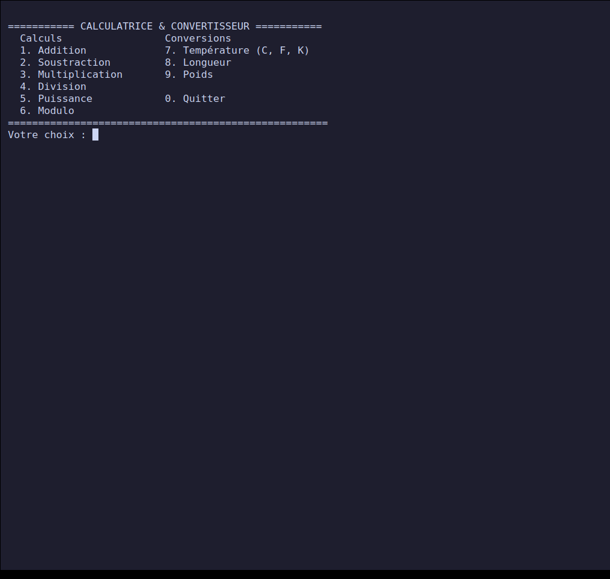
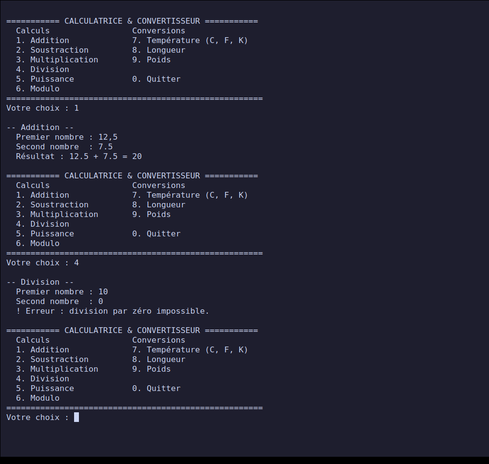
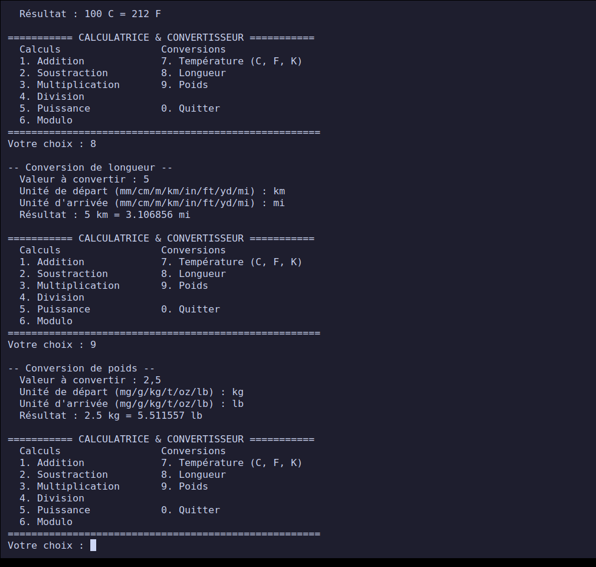
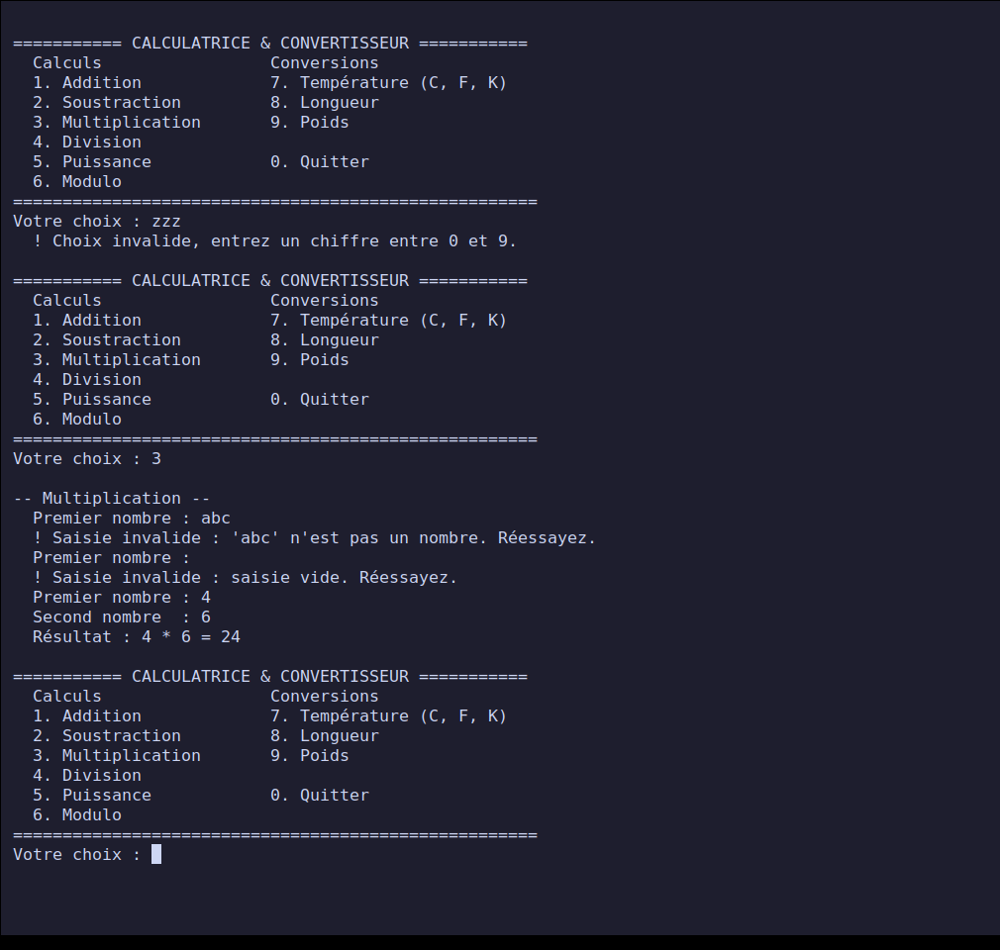
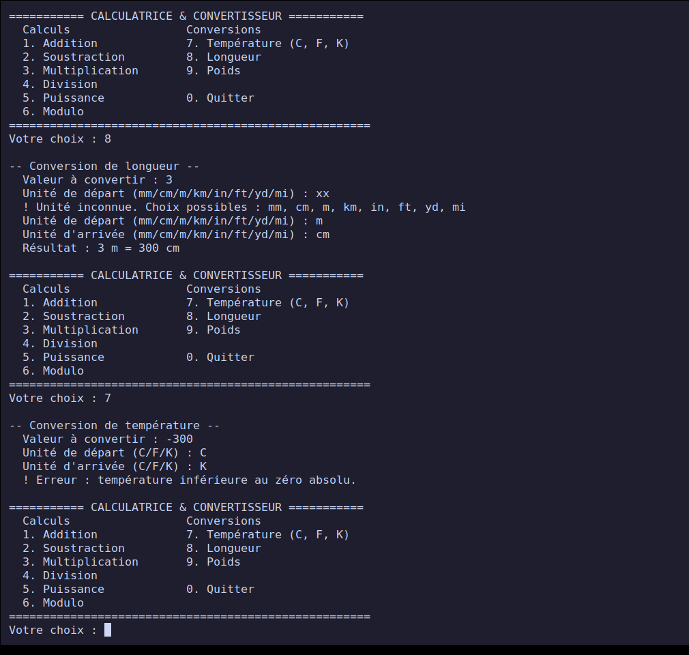
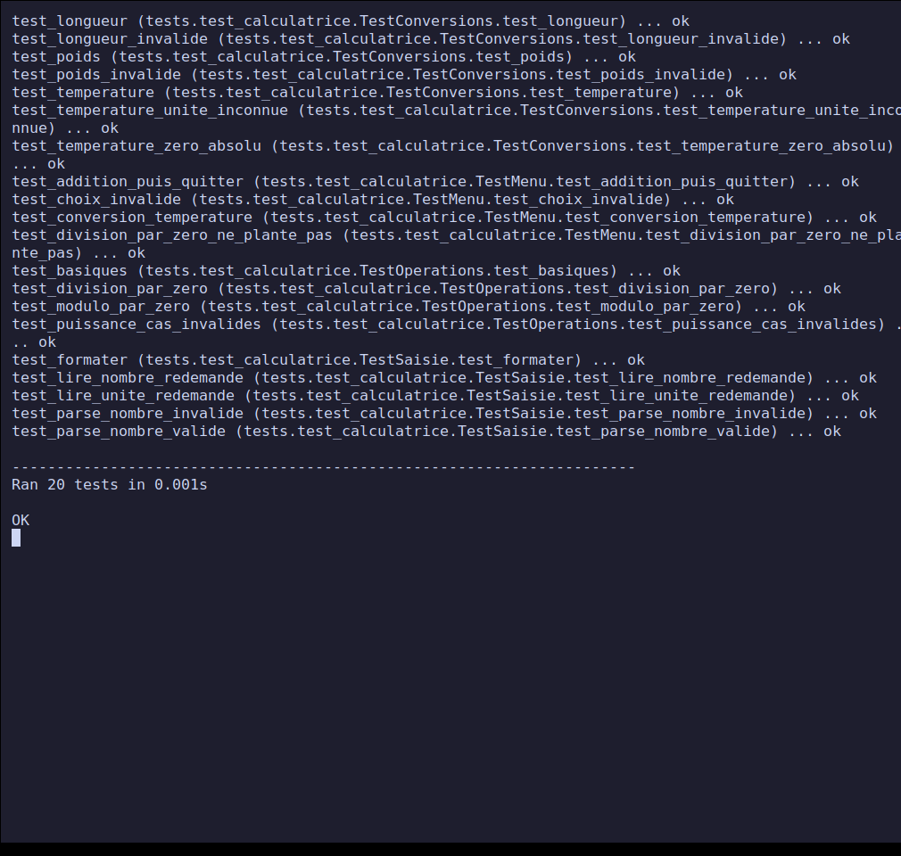

# Project 1 — Command-line calculator and unit converter

**PPE deliverable — Course *Python — Fundamentals* (class E3).**
Completed on **26 October 2026**. Level: beginner.

A small educational command-line tool: six calculation operations and three unit
converters (temperature, length, weight), with input protected against errors (text,
empty value, division by zero, unknown unit, absolute zero). Standard Python 3 code,
**with no dependencies at all**.

## Contents

- [Progress](#progress)
- [Quick start](#quick-start)
- [Features](#features)
- [Repository structure](#repository-structure)
- [Design](#design)
- [Screenshots](#screenshots)
- [Tests and validation](#tests-and-validation)
- [Difficulties and decisions](#difficulties-and-decisions)
- [Mapping to the project brief](#mapping-to-the-project-brief)
- [Sources](#sources)

## Progress

| Brief step | Status |
| --- | --- |
| 1. Define the operations and conversions | Done |
| 2. One function per operation/conversion | Done |
| 3. Interactive command-line menu | Done |
| 4. Input error handling | Done |
| 5. Tests with several scenarios, including invalid cases | Done: 20 automated tests (OK) + 28 documented manual cases |
| Deliverable: commented Python script | [`calculatrice.py`](./calculatrice.py) |
| Deliverable: documented manual test set | [`TESTS-MANUELS.md`](./TESTS-MANUELS.md) |
| Deliverable: short user guide | [`NOTICE.md`](./NOTICE.md) |

## Quick start

Prerequisites: Python 3.8 or newer (tested with Python 3.12.3 on Linux).

```bash
git clone https://github.com/xbkh/python-ppe-e3.git
cd python-ppe-e3/projet-1-calculatrice-convertisseur
python3 calculatrice.py
```

Run the automated tests:

```bash
python3 -m unittest -v
```

## Features

| Menu | Function | Detail |
| --- | --- | --- |
| 1 | Addition | `a + b` |
| 2 | Subtraction | `a - b` |
| 3 | Multiplication | `a * b` |
| 4 | Division | rejects division by zero |
| 5 | Power | rejects `0` to a negative power, non-real results and overflows |
| 6 | Modulo | rejects modulo by zero |
| 7 | Temperature | `C`, `F`, `K`, rejects values below absolute zero |
| 8 | Length | `mm`, `cm`, `m`, `km`, `in`, `ft`, `yd`, `mi`, rejects negative values |
| 9 | Weight | `mg`, `g`, `kg`, `t`, `oz`, `lb`, rejects negative values |
| 0 | Quit | |

The decimal comma (`2,5`) is accepted like the dot (`2.5`). Units are not
case-sensitive (`KM` = `km`).

## Repository structure

```text
.
├── calculatrice.py            # the program (logic + menu)
├── tests/
│   └── test_calculatrice.py   # 20 automated tests (unittest)
├── tools/
│   └── capture.sh             # generates the screenshots
├── screenshots/               # screenshots used below
├── TESTS-MANUELS.md           # manual test set (inputs / outputs)
├── NOTICE.md                  # user guide
└── README.md
```

## Design

The code separates two layers:

1. **Pure logic**: one function per operation (`addition`, `division`, ...)
   and per conversion (`convertir_temperature`, `convertir_longueur`,
   `convertir_poids`). They receive parameters, return a value and
   report a problem with `ValueError`. None of them reads the keyboard or
   prints anything, which makes them testable on their own.
2. **Interface**: `parse_nombre`, `lire_nombre` and `lire_unite` validate the
   input and ask again until it is valid; `main` displays the menu and
   calls the right function. The input function is a parameter
   (`saisie=input`), which makes it possible to simulate a user in the tests.

Length and weight conversions use **a pivot unit** (metre,
kilogram): a table of factors is enough, and adding a unit means
adding one line. Temperature goes through Celsius.

## Screenshots

The screenshots show the **real program** running in a terminal. They are
produced by [`tools/capture.sh`](./tools/capture.sh): isolated virtual screen
(Xvfb), xterm terminal, keys sent by `xdotool`, capture by `scrot`.
The script is provided, so the screenshots are reproducible.

### 1. Main menu



### 2. Calculations: addition, then division by zero rejected

Input: `1` → `12,5` → `7.5` (comma and dot accepted), then `4` → `10` → `0`.



### 3. Conversions: temperature, length, weight

`100 C = 212 F`, `5 km = 3.106856 mi`, `2.5 kg = 5.511557 lb`.



### 4. Invalid input: menu choice and numbers

A menu choice `zzz`, then in the multiplication a number `abc` and an
empty input are rejected and asked again; the program does not crash.



### 5. Invalid input: units and absolute zero

Unit `xx` rejected with the list of choices; `-300 C` to Kelvin rejected because
it is below absolute zero.



### 6. Automated tests

20 tests, all passing.



## Tests and validation

| Type | Content | Result |
| --- | --- | --- |
| Automated (`unittest`) | operations, conversions, edge cases, input, full menu | 20/20 OK |
| Documented manual | 28 cases with inputs, expected result and observed result | see [`TESTS-MANUELS.md`](./TESTS-MANUELS.md) |
| Screenshots | 6 screenshots of the real program | above |

Invalid cases covered: menu choice outside the list, text instead of a
number, empty input, `nan` / `inf` / overflow (`1e999`), division and modulo
by zero, `0` to a negative power, root of a negative number, unknown unit, negative
value for a length or weight, temperature below absolute zero, end of
input (`Ctrl+D`) and interruption (`Ctrl+C`).

## Difficulties and decisions

- **No pytest.** The `unittest` module is part of the standard
  library: the project therefore has no dependency to install. (`pytest` is
  the subject of project 5.)
- **Floating-point numbers.** `0.1 + 0.2` equals `0.30000000000000004` in binary.
  The display is rounded to 6 decimals without useless zeros (`formater`), which
  shows `0.3`. The conversion tests compare with `assertAlmostEqual`.
- **`nan`, `inf` and `1e999`.** `float("nan")` is accepted by Python as a valid
  number; it would have produced absurd results. `parse_nombre`
  rejects anything that is not finite.
- **Absolute zero.** Checked in Celsius after conversion to the pivot unit, which
  covers negative `K` and too-low `C` / `F` with a single rule.
- **Screenshots in a virtual screen** rather than on the desktop: they only
  show the program's terminal, no other windows. The first
  version of scenario 4 was out of sync (one extra input): spotted while
  reviewing the screenshot, scenario fixed and screenshots regenerated.
- **Test discovery.** Without a `tests/__init__.py` file, `python3 -m unittest`
  answers "NO TESTS RAN": the folder is not explored. The empty file was
  added (observed at run time, then fixed).

## Mapping to the project brief

| Evaluation criterion | Weight | Where to find it |
| --- | --- | --- |
| Technical implementation | 30% | [`calculatrice.py`](./calculatrice.py), [Design](#design) section |
| Following the instructions | 25% | [progress](#progress) table: the 5 steps and the 3 deliverables |
| Tests / validation | 25% | [`TESTS-MANUELS.md`](./TESTS-MANUELS.md), [`tests/`](./tests/), screenshots |
| Documentation | 20% | this README, [`NOTICE.md`](./NOTICE.md), code docstrings |

## Sources

- Project brief: [Satom-IT-Learning-Solutions/E3 — Project 1](https://github.com/Satom-IT-Learning-Solutions/E3/blob/main/02-python-principes-de-base/projet-1-calculatrice-convertisseur.md)
- [Python — Official tutorial](https://docs.python.org/3/tutorial/)
- [Python — Exception handling](https://docs.python.org/3/tutorial/errors.html)
- [Python — `unittest`](https://docs.python.org/3/library/unittest.html)
