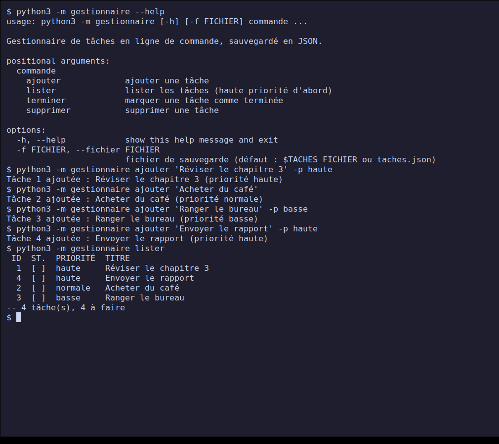
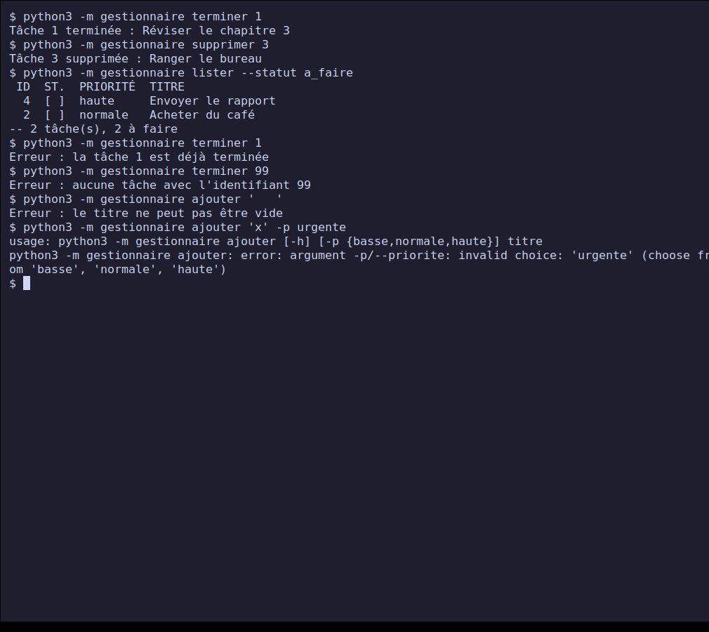
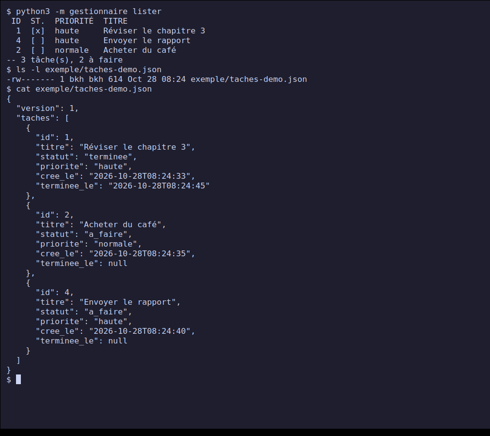
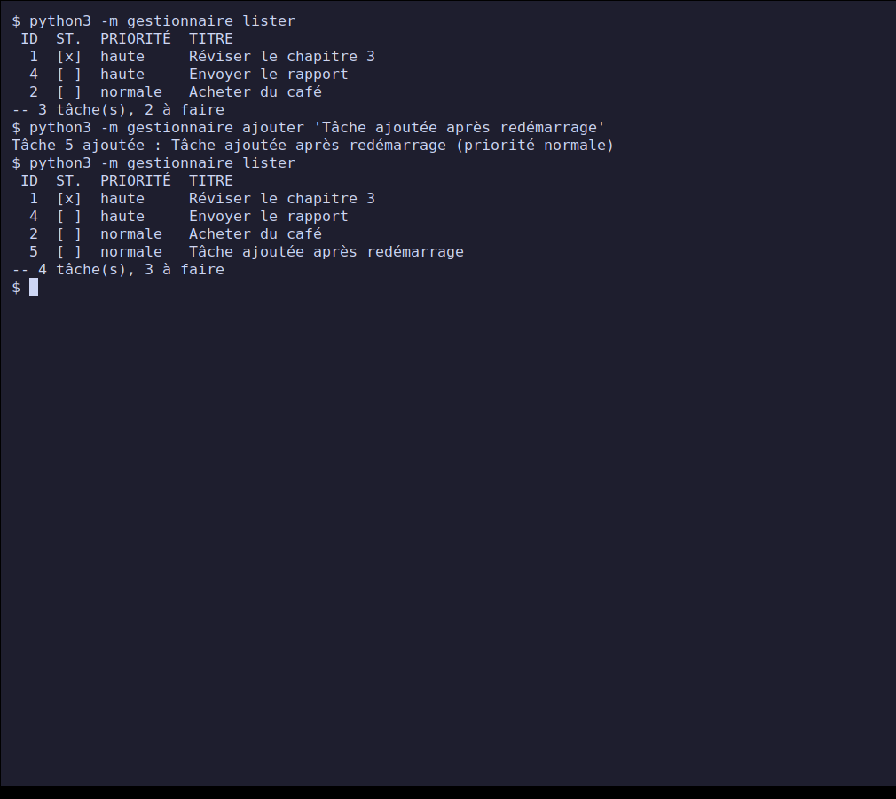
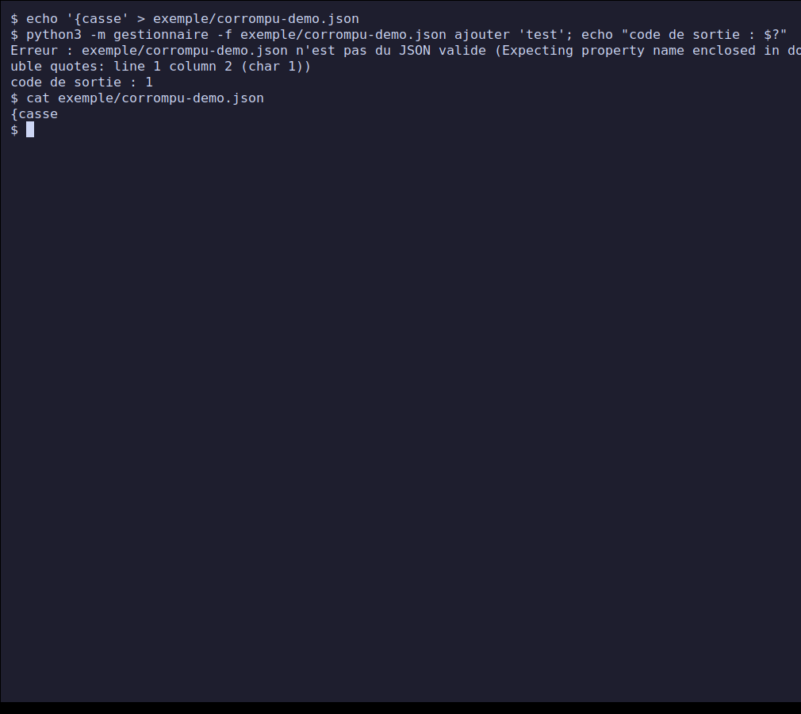
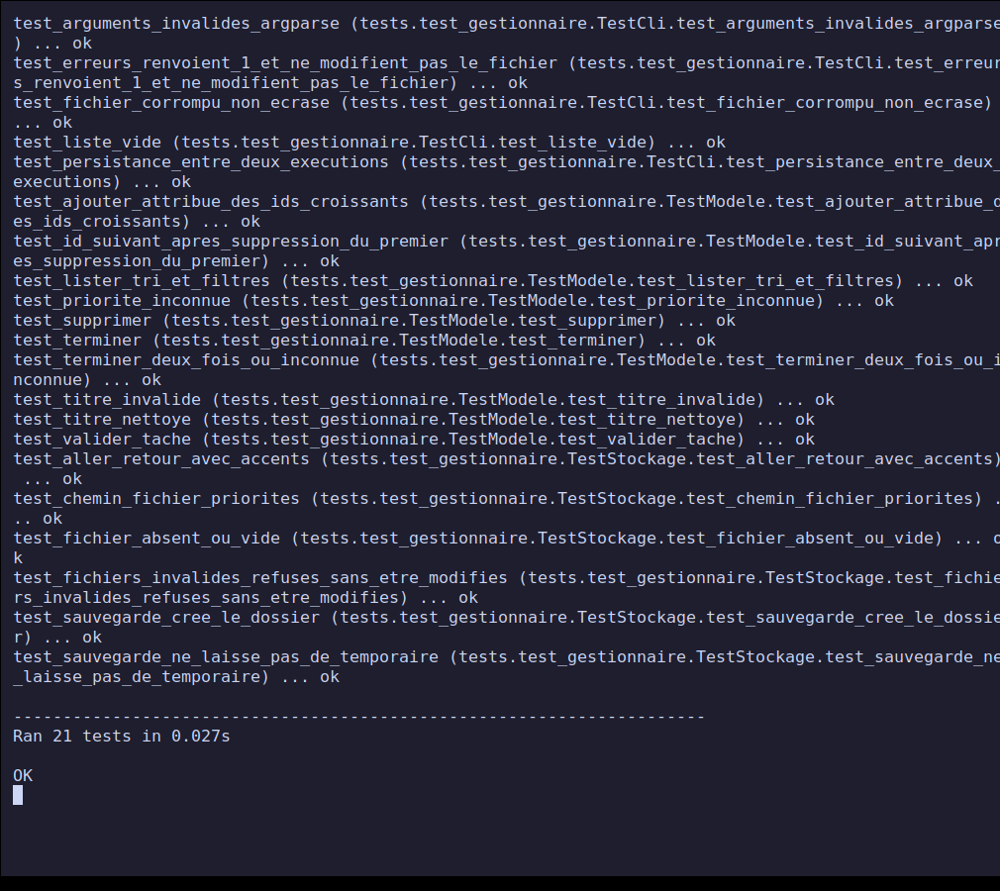

# Project 2 — Command-line task manager

**PPE deliverable — Course *Python — Fundamentals* (class E3).**
Completed on **28 October 2026**. Level: beginner / intermediate.

Command-line tool to keep track of a task list (add, list, complete,
delete) **without any online service**. Tasks are saved to a JSON file
on every change and reloaded at startup: they survive closing the
program. Standard Python 3, **no dependencies**.

## Contents

- [Progress](#progress)
- [Quick start](#quick-start)
- [Repository structure](#repository-structure)
- [Design](#design)
- [Screenshots](#screenshots)
- [Tests and validation](#tests-and-validation)
- [Difficulties and decisions](#difficulties-and-decisions)
- [Mapping to the project brief](#mapping-to-the-project-brief)
- [Sources](#sources)

## Progress

| Brief step | Status |
| --- | --- |
| 1. Model a task (title, status, priority) as a dictionary | Done: [`modele.py`](./gestionnaire/modele.py) |
| 2. Operations: add, list, complete, delete | Done (plus: list filters) |
| 3. Save to a file on every change | Done: [`stockage.py`](./gestionnaire/stockage.py), atomic write |
| 4. Load tasks at startup | Done, with file validation |
| 5. Test persistence after closing and reopening | Done: screenshots [03](#3-persistence-before-closing) and [04](#4-persistence-after-restart) |
| Deliverable: source code | [`gestionnaire/`](./gestionnaire/) |
| Deliverable: documented save format | [`FORMAT-FICHIER.md`](./FORMAT-FICHIER.md) |
| Deliverable: proof of persistence (before / after restart) | screenshots 03 and 04, file [`exemple/taches-demo.json`](./exemple/taches-demo.json) |

## Quick start

Prerequisites: Python 3.8 or newer (tested with Python 3.12.3 on Linux).

```bash
git clone https://github.com/xbkh/python-ppe-e3.git
cd python-ppe-e3/projet-2-gestionnaire-taches-cli

python3 -m gestionnaire ajouter "Réviser le chapitre 3" -p haute
python3 -m gestionnaire ajouter "Acheter du café"
python3 -m gestionnaire lister
python3 -m gestionnaire terminer 1
python3 -m gestionnaire supprimer 2
```

All options are described in [`NOTICE.md`](./NOTICE.md). Run the tests:

```bash
python3 -m unittest -v
```

## Repository structure

```text
.
├── gestionnaire/
│   ├── __main__.py      # entry point: python3 -m gestionnaire
│   ├── cli.py           # interface: arguments, display, exit codes
│   ├── modele.py        # business logic: the task and its operations (no input/output)
│   └── stockage.py      # reading / writing / validating the JSON file
├── tests/test_gestionnaire.py   # 21 automated tests (unittest)
├── tools/capture.sh             # generates the screenshots
├── exemple/taches-demo.json     # file produced by the screenshot scenario
├── screenshots/                 # screenshots used below
├── FORMAT-FICHIER.md            # documented save format
├── TESTS-MANUELS.md             # 25 manual cases (command, expected, observed)
├── NOTICE.md                    # user guide
└── README.md
```

## Design

The program is split into **three modules** with separate roles:

| Module | Role | What it does not do |
| --- | --- | --- |
| `modele.py` | a task is a `dict`, the list is a `list` of `dict`; functions `ajouter`, `lister`, `terminer`, `supprimer`, `valider_tache` | no disk access, no `print` |
| `stockage.py` | `charger`, `sauvegarder`, choice of the file path | no business rule about tasks |
| `cli.py` | arguments (`argparse`), display, conversion of errors into messages and exit codes | no direct manipulation of the JSON |

A task:

```python
{"id": 1, "titre": "Réviser le chapitre 3", "statut": "a_faire",
 "priorite": "haute", "cree_le": "2026-10-28T08:24:33", "terminee_le": None}
```

Design choices:

- **One command = one run.** The program loads the file, applies the
  operation, saves, then stops. Persistence is therefore what allows
  commands to be chained, and it can be tested directly.
- **Business errors are `ValueError`s**, file errors are
  `ErreurStockage`; `cli.main` catches them and returns code 1 with a message
  on the error output, never a Python traceback.
- **Atomic write** (temporary file then `os.replace`): a power cut
  during saving cannot truncate the file.
- **An invalid file is never overwritten.** If the JSON is broken or malformed,
  the program stops without changing anything, instead of starting from an empty list
  and destroying the data on the next addition.

## Screenshots

The screenshots show the **real program**: the commands are actually typed
in a terminal (isolated Xvfb virtual screen, `xterm`, `xdotool`, `scrot`). The script
[`tools/capture.sh`](./tools/capture.sh) regenerates them. The demo file
is chosen by the `TACHES_FICHIER` variable (not visible in the screenshots).

### 1. Help and adding tasks



Four tasks added with different priorities; `lister` displays them by
decreasing priority (high, normal, low), then by ID.

### 2. Complete, delete, filter, errors



Task 1 is completed, task 3 deleted, `lister --statut a_faire` filters. Then four
errors: task already completed, unknown ID, empty title, unknown priority
(`argparse` message, in English).

### 3. Persistence, before closing



State of the list, size and date of the file, then its full JSON content. The
terminal is then **closed**: the program and its memory disappear.

### 4. Persistence, after restart



In a **new terminal**, `lister` finds exactly the same three tasks
(including the completed task 1). A new addition gets ID 5, the logical continuation of the
numbering.

### 5. Corrupted file rejected and never overwritten



On a file containing `{casse`, the addition is rejected (exit code 1) and the
`cat` shows that the file was left intact.

### 6. Automated tests



## Tests and validation

| Type | Content | Result |
| --- | --- | --- |
| Automated (`unittest`) | model (IDs, titles, priorities, sorting, filters), storage (round trip with accents, invalid files, atomic write), CLI (persistence, errors, exit codes) | 21/21 OK, no warnings (`-W error`) |
| Documented manual | 25 cases: command, expected, observed, exit code | 25/25 passing, see [`TESTS-MANUELS.md`](./TESTS-MANUELS.md) |
| Proof of persistence | screenshots 03 and 04 + automated test `test_persistance_entre_deux_executions` | passing |

## Difficulties and decisions

- **Capturing persistence.** Showing "before / after restart" requires two separate
  terminals. The script opens one, closes it, then opens a second one. A
  first version typed `clear; command` on a single line, which erased the
  command line from the screenshot; fixed with two separate keystrokes.
- **Identifiers.** Computed as "largest ID + 1". Simple and with no counter to
  save, but the ID of the last deleted task is reused. Observed in
  manual case 9 and documented in the [limitations](./FORMAT-FICHIER.md#limites-connues),
  rather than adding a persistent counter outside the scope of a beginner brief.
- **No file lock.** Two simultaneous runs can overwrite each other;
  accepted for a single-user tool, noted in the limitations.
- **`argparse` messages in English** (`invalid choice`, `required`). The business
  messages are in French; translating the `argparse` ones was not done.
- **Read-only file.** The atomic rename replaces the file even if it is
  read-only, in a writable folder: observed during a trial, noted in
  the limitations.
- **No `pytest`**, `unittest` is enough and avoids any dependency (`pytest` is
  the subject of project 5).

## Mapping to the project brief

| Evaluation criterion | Weight | Where to find it |
| --- | --- | --- |
| Technical implementation | 30% | [`gestionnaire/`](./gestionnaire/), [Design](#design) section |
| Following the instructions | 25% | [progress](#progress) table: 5 steps and 3 deliverables |
| Tests / validation | 25% | [`TESTS-MANUELS.md`](./TESTS-MANUELS.md), [`tests/`](./tests/), screenshots 03 to 06 |
| Documentation | 20% | this README, [`FORMAT-FICHIER.md`](./FORMAT-FICHIER.md), [`NOTICE.md`](./NOTICE.md), docstrings |

## Sources

- Project brief: [Satom-IT-Learning-Solutions/E3 — Project 2](https://github.com/Satom-IT-Learning-Solutions/E3/blob/main/02-python-principes-de-base/projet-2-gestionnaire-taches-cli.md)
- [Python — File handling](https://docs.python.org/3/tutorial/inputoutput.html)
- [Python — json module](https://docs.python.org/3/library/json.html)
- [Python — `argparse`](https://docs.python.org/3/library/argparse.html)
- [Python — `os.replace`](https://docs.python.org/3/library/os.html#os.replace)
