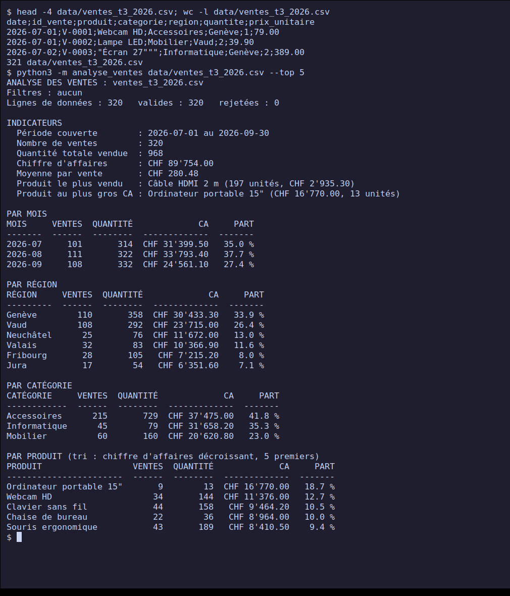
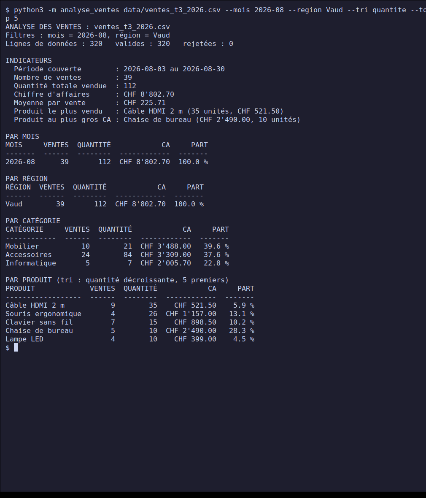
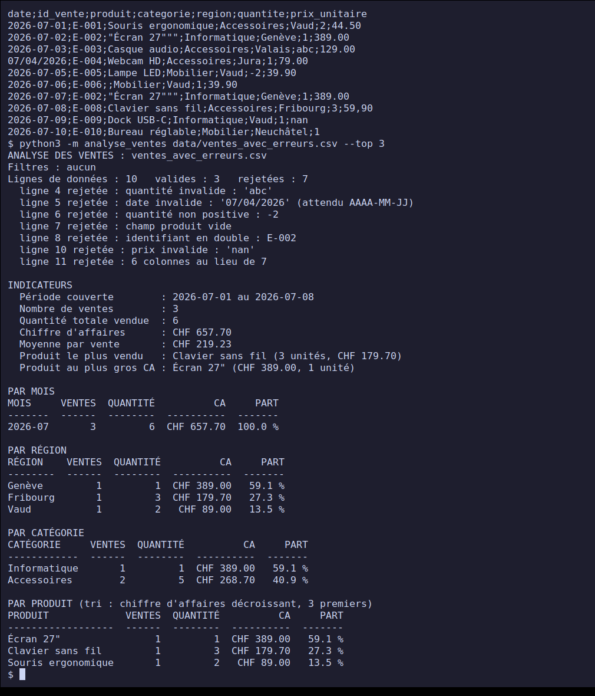
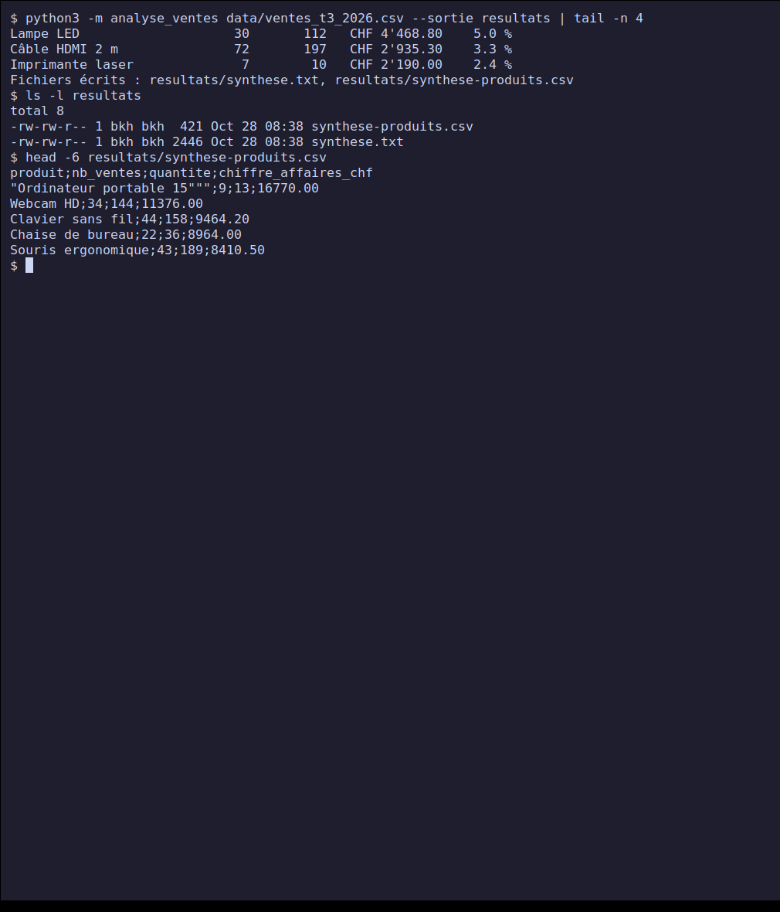
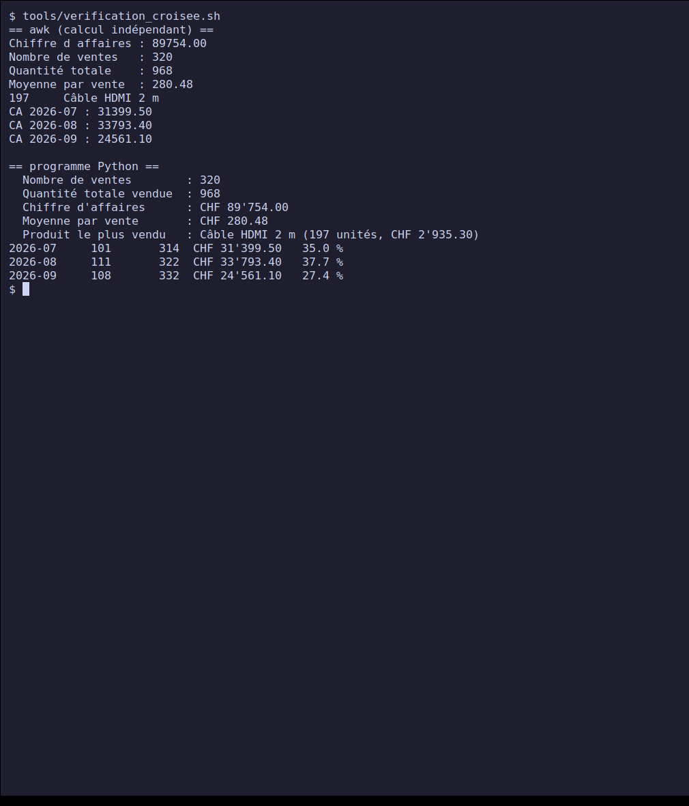
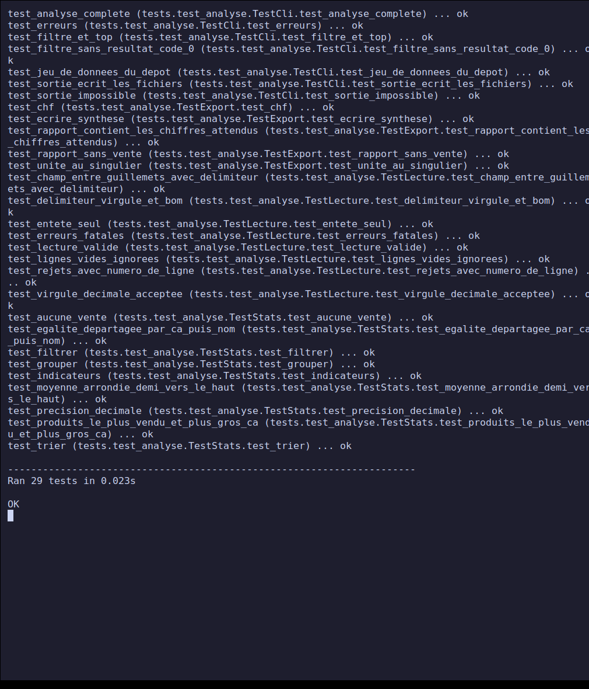

# Project 3 — Analysing a sales CSV file

**PPE deliverable — Course *Python — Fundamentals* (class E3).**
Completed on **28 October 2026**. Level: intermediate.

Command-line tool that reads the CSV export of a quarter's sales and extracts
statistics from it without opening Excel: revenue, average per sale, best-selling
product, groupings by month, region, category and product, filters, sorting and export
of a summary. Standard Python 3 (`csv` module), **no pandas or other dependency**.

## Contents

- [Progress](#progress)
- [Quick start](#quick-start)
- [Repository structure](#repository-structure)
- [The data](#the-data)
- [Design](#design)
- [Screenshots](#screenshots)
- [Tests and validation](#tests-and-validation)
- [Difficulties and decisions](#difficulties-and-decisions)
- [Mapping to the project brief](#mapping-to-the-project-brief)
- [Sources](#sources)

## Progress

| Brief step | Status |
| --- | --- |
| 1. Get or generate a realistic sales CSV dataset | Done: 320 sales over Q3 2026, [generated](./tools/generer_donnees.py) with a fixed seed |
| 2. Read the file with the `csv` module | Done: [`lecture.py`](./analyse_ventes/lecture.py), pandas not used |
| 3. Total revenue, average per sale, best-selling product | Done: [`stats.py`](./analyse_ventes/stats.py) |
| 4. Sort and filter by a criterion (month, region) | Done: month, region, category filters; `ca`, `quantite`, `nom` sorts; `--top` |
| 5. Export a clear summary | Done: text and CSV report, [`resultats/`](./resultats/) |
| Deliverable: commented analysis script | [`analyse_ventes/`](./analyse_ventes/) |
| Deliverable: generated summary file | [`resultats/synthese.txt`](./resultats/synthese.txt) and [`resultats/synthese-produits.csv`](./resultats/synthese-produits.csv) |
| Deliverable: note explaining the calculation method | [`METHODE.md`](./METHODE.md) |

## Quick start

Prerequisites: Python 3.8 or newer (tested with Python 3.12.3 on Linux).

```bash
git clone https://github.com/xbkh/python-ppe-e3.git
cd python-ppe-e3/projet-3-analyse-csv-ventes

python3 -m analyse_ventes data/ventes_t3_2026.csv
python3 -m analyse_ventes data/ventes_t3_2026.csv --mois 2026-08 --region Vaud --tri quantite --top 5
python3 -m analyse_ventes data/ventes_t3_2026.csv --sortie resultats
```

All options are in [`NOTICE.md`](./NOTICE.md). Run the tests:

```bash
python3 -m unittest -v
```

## Repository structure

```text
.
├── analyse_ventes/
│   ├── __main__.py     # entry point: python3 -m analyse_ventes
│   ├── cli.py          # arguments and orchestration
│   ├── lecture.py      # CSV reading, row-by-row validation, rejections
│   ├── stats.py        # calculations (Decimal): revenue, average, groupings, sorting, filters
│   └── export.py       # report formatting, summary writing
├── data/
│   ├── ventes_t3_2026.csv       # 320 valid sales (fictional)
│   └── ventes_avec_erreurs.csv  # 10 rows, 7 of them invalid
├── resultats/                   # summary produced on the full dataset
├── tests/test_analyse.py        # 29 automated tests (unittest)
├── tools/
│   ├── generer_donnees.py       # generates the two CSVs (reproducible)
│   ├── verification_croisee.sh  # independent recomputation with awk
│   └── capture.sh               # generates the screenshots
├── screenshots/
├── METHODE.md          # calculation method (deliverable)
├── TESTS-MANUELS.md    # 21 manual cases, cross-checked with awk
├── NOTICE.md           # user guide
└── README.md
```

## The data

The data is **fictional**: an export from an office-supplies SME, from 1 July to
30 September 2026, 12 products in 3 categories (IT, accessories, furniture),
6 French-speaking Swiss regions. The generator applies popularity weights, sells
expensive items one at a time and small ones in batches, and reduces activity on weekends. It is
deterministic (fixed seed): the same file is reproduced on every run.

```text
date;id_vente;produit;categorie;region;quantite;prix_unitaire
2026-07-01;V-0001;Webcam HD;Accessoires;Genève;1;79.00
```

A second file, `ventes_avec_erreurs.csv`, contains the typical defects of a real
export (non-numeric quantity, wrongly formatted date, negative quantity, empty field,
duplicate ID, `nan` price, missing column, decimal comma) to test
robustness.

## Design

Four modules, one responsibility each:

| Module | Role | What it does not do |
| --- | --- | --- |
| `lecture.py` | `lire_ventes` returns the valid sales, the rejections (line number + reason) and the number of lines | no statistical calculation |
| `stats.py` | `chiffre_affaires`, `moyenne_par_vente`, `grouper`, `trier`, `filtrer`, `produit_le_plus_vendu` | no file reading, no display |
| `export.py` | aligned text report, amounts in CHF, writing of `synthese.txt` and `synthese-produits.csv` | no calculation |
| `cli.py` | `argparse` arguments, sequencing, exit codes | no business logic |

Main design decisions:

- **An invalid row does not stop the analysis.** It is skipped and reported (number,
  reason); only an unusable file (missing, empty, badly encoded, missing columns)
  gives an error. The report always shows how many rows were read, kept and
  rejected.
- **`Decimal` for money**, not `float`: sums are exact (see
  [`METHODE.md`](./METHODE.md)).
- **Explicit definitions**: "best-selling" = most units; the product with the highest
  revenue is displayed next to it.
- **Deterministic results**: every sorting tie is broken in a fixed way.

## Screenshots

The screenshots show the **real program**: commands actually typed in a
terminal (Xvfb virtual screen, `xterm`, `xdotool`, `scrot`). [`tools/capture.sh`](./tools/capture.sh)
regenerates them, as well as [`resultats/`](./resultats/).

### 1. CSV preview and full analysis



The 320 sales: revenue CHF 89'754.00, average CHF 280.48. The best-selling product is the
HDMI cable (197 units) but the highest revenue comes from the laptop
(only 13 units).

### 2. Filters, sorting and top



August, Vaud region, products sorted by quantity, top 5.

### 3. Invalid rows skipped



Out of 10 rows, 7 are rejected with their number and reason; the 3 valid ones are
analysed (including the row with price `59,90`, decimal comma accepted).

### 4. Summary export



### 5. Cross-check with `awk`



`awk` recomputes the indicators without the Python code: same values, to the cent.

### 6. Automated tests



## Tests and validation

| Type | Content | Result |
| --- | --- | --- |
| Automated (`unittest`) | reading (delimiters, BOM, quotes, eight kinds of rejected rows, fatal errors), statistics on a 4-sale dataset computed by hand, decimal precision, ties, filters, sorting, export, CLI | 29/29 OK, no warnings (`-W error`) |
| Documented manual | 21 cases, cross-checked with `awk` where possible | 21/21 passing, see [`TESTS-MANUELS.md`](./TESTS-MANUELS.md) |
| Cross-check | independent recomputation in `awk` of the indicators and monthly revenue | identical to the cent |

## Difficulties and decisions

- **Alphabetical sorting and accents.** The first sorting test failed: Python sorts
  "Écran" after "Souris", because accented letters come after `z` in character
  order. Fixed with a sort key that ignores accents and case (`cle_alpha`).
- **A badly written test on my part.** Another failure in the same run came from a wrong
  expected count in the test (9 instead of 10 data rows), not from the program;
  fixed in the test.
- **Floats.** With `float`, sums of amounts risk rounding errors; with
  `Decimal`, they are exact and the `awk` cross-check matches.
- **`1 unités`.** The first output displayed "1 unités": singular agreement added.
- **Empty rows and separators.** Empty rows (or rows made only of separators)
  are ignored without counting as rejections, since they often slip in at the end of
  exported files.
- **Fictional data.** No real commercial data is used.
- **`argparse` messages** (`invalid choice`, `required`) remain in English.
- **No pandas**: the `csv` module is enough for this file size, and the
  brief suggests it as the first option.

## Mapping to the project brief

| Evaluation criterion | Weight | Where to find it |
| --- | --- | --- |
| Technical implementation | 30% | [`analyse_ventes/`](./analyse_ventes/), [Design](#design) section |
| Following the instructions | 25% | [progress](#progress) table: 5 steps and 3 deliverables |
| Tests / validation | 25% | [`TESTS-MANUELS.md`](./TESTS-MANUELS.md), [`tests/`](./tests/), screenshots 03 to 06 |
| Documentation | 20% | this README, [`METHODE.md`](./METHODE.md), [`NOTICE.md`](./NOTICE.md), docstrings |

## Sources

- Project brief: [Satom-IT-Learning-Solutions/E3 — Project 3](https://github.com/Satom-IT-Learning-Solutions/E3/blob/main/02-python-principes-de-base/projet-3-analyse-csv-ventes.md)
- [Python — csv module](https://docs.python.org/3/library/csv.html)
- [Python — decimal module](https://docs.python.org/3/library/decimal.html)
- [Python — unicodedata module](https://docs.python.org/3/library/unicodedata.html)
