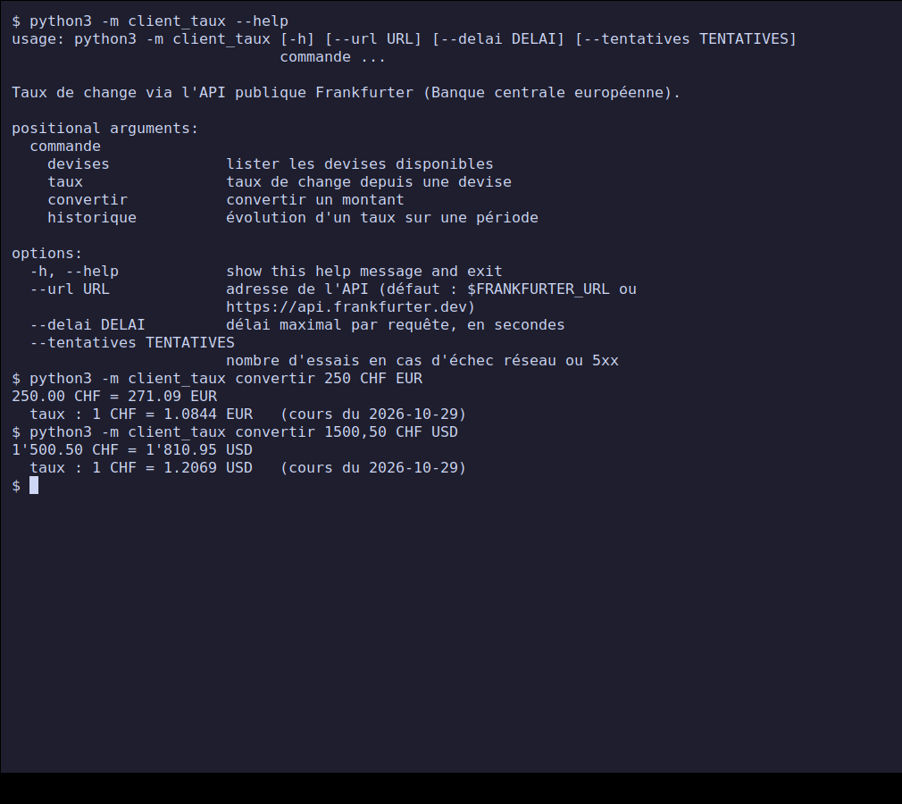
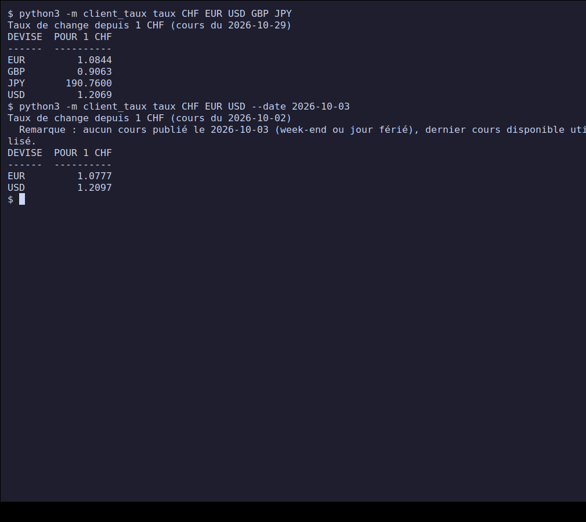
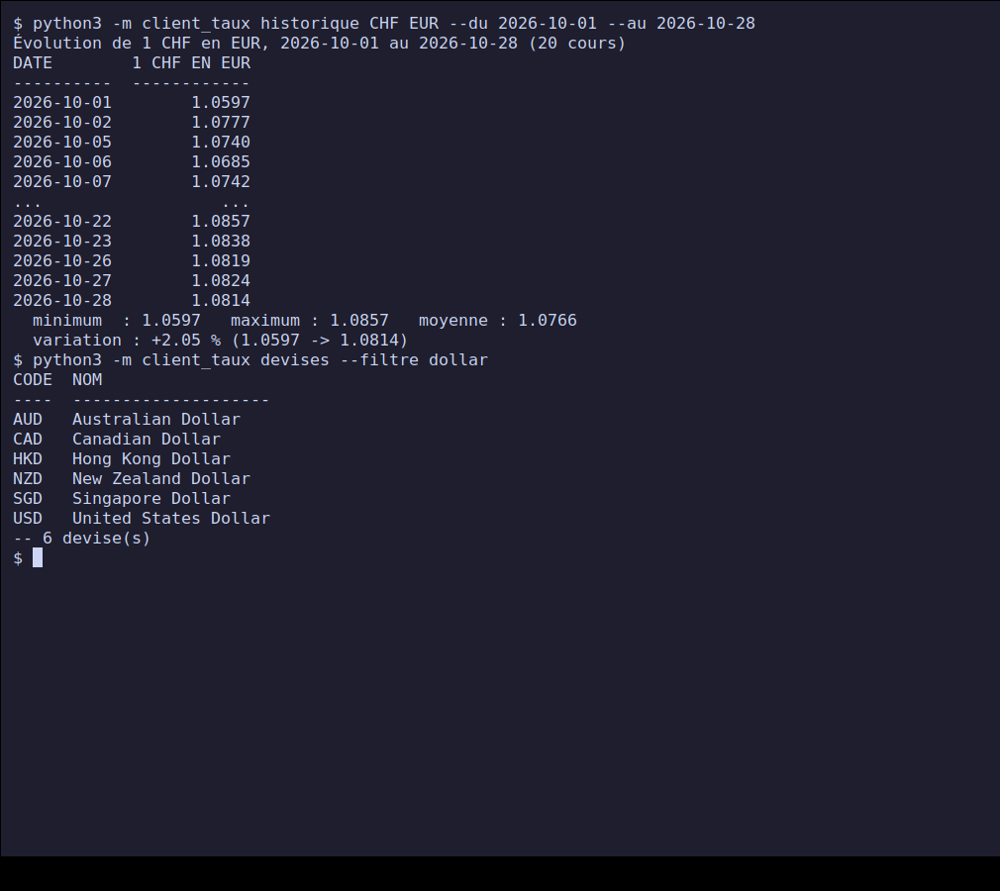
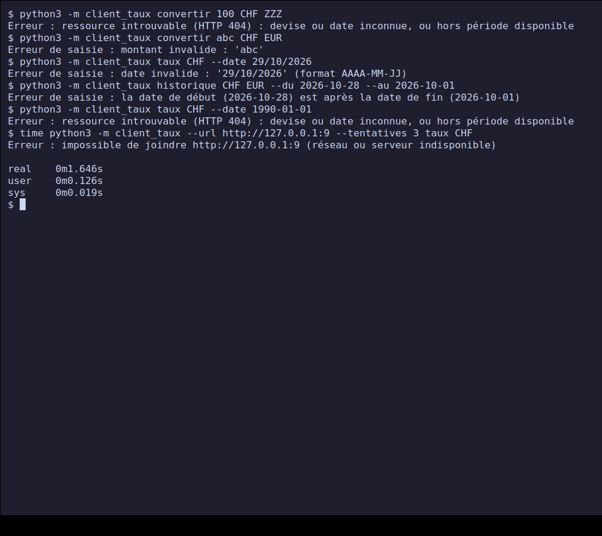
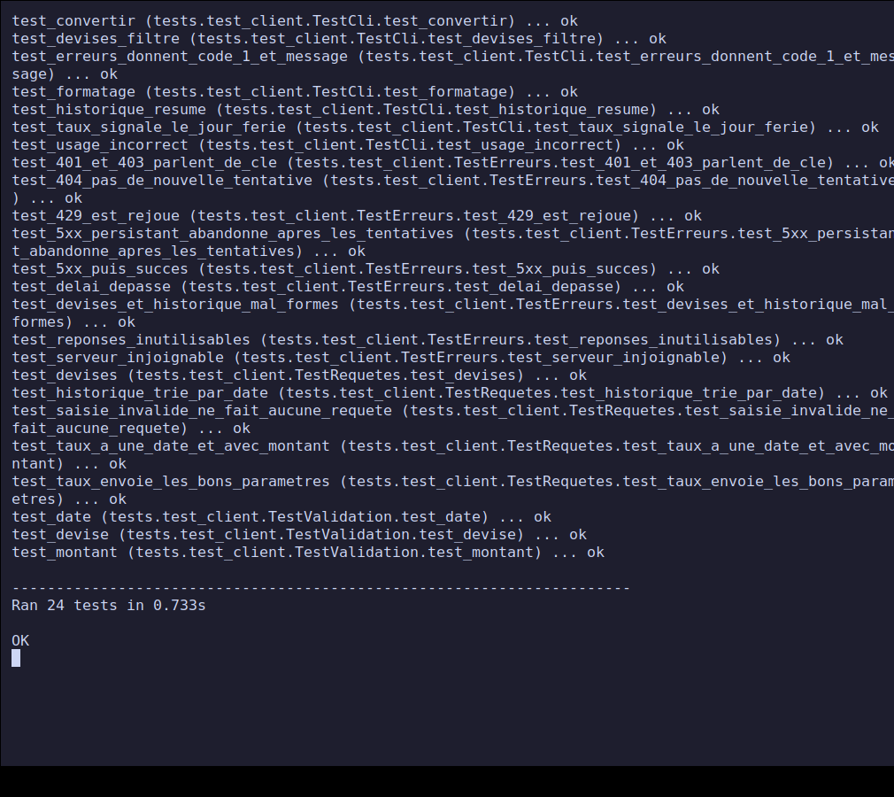

# Project 4 — Public API client in Python

**PPE deliverable — Course *Python — Fundamentals* (class E3).**
Completed on **30 October 2026**. Level: intermediate / advanced.

Command-line client for the **Frankfurter public API** (European Central Bank
exchange rates): amount conversion, rate of the day or of a past day, evolution
of a rate over a period, list of currencies. HTTP requests with the `requests` library,
JSON response parsing, careful handling of network errors and invalid responses.

## Contents

- [Progress](#progress)
- [Quick start](#quick-start)
- [Repository structure](#repository-structure)
- [Choice of the API](#choice-of-the-api)
- [Design](#design)
- [Screenshots](#screenshots)
- [Tests and validation](#tests-and-validation)
- [Difficulties and decisions](#difficulties-and-decisions)
- [Mapping to the project brief](#mapping-to-the-project-brief)
- [Sources](#sources)

## Progress

| Brief step | Status |
| --- | --- |
| 1. Choose a suitable free public API | Done: Frankfurter, see [Choice of the API](#choice-of-the-api) |
| 2. GET request with `requests` | Done: [`api.py`](./client_taux/api.py) |
| 3. Parse the JSON response and extract the relevant fields | Done, with validation of every field |
| 4. Handle errors (API unavailable, missing key, missing data) | Done: [`GESTION-ERREURS.md`](./GESTION-ERREURS.md) |
| 5. Present the results readably on the command line | Done: [`cli.py`](./client_taux/cli.py) |
| Deliverable: API client script | [`client_taux/`](./client_taux/) |
| Deliverable: sample output for at least 3 different requests | 4 requests in [`exemples/sortie-exemples.txt`](./exemples/sortie-exemples.txt) and screenshots 1 to 3 |
| Deliverable: note on error handling | [`GESTION-ERREURS.md`](./GESTION-ERREURS.md) |

## Quick start

Prerequisites: Python 3.8 or newer, Internet access, `requests` library
(tested with Python 3.12.3 and `requests` 2.31.0 on Linux).

```bash
git clone https://github.com/xbkh/python-ppe-e3.git
cd python-ppe-e3/projet-4-client-api-publique
python3 -m venv .venv && . .venv/bin/activate
pip install -r requirements.txt

python3 -m client_taux convertir 250 CHF EUR
python3 -m client_taux taux CHF EUR USD GBP
python3 -m client_taux historique CHF EUR --du 2026-10-01 --au 2026-10-28
python3 -m client_taux devises --filtre dollar
```

Command details: [`NOTICE.md`](./NOTICE.md). Tests (no Internet access needed):

```bash
python3 -m unittest -v
```

## Repository structure

```text
.
├── client_taux/
│   ├── __main__.py   # entry point: python3 -m client_taux
│   ├── api.py        # requests (requests), validations, errors, retries
│   └── cli.py        # commands, formatting, exit codes
├── tests/
│   ├── serveur_factice.py   # small local HTTP server that simulates the API
│   └── test_client.py       # 24 automated tests (unittest)
├── tools/
│   ├── capture.sh    # screenshots (against the real API)
│   └── exemples.sh   # records real outputs into exemples/
├── exemples/sortie-exemples.txt
├── screenshots/
├── GESTION-ERREURS.md   # note on error handling (deliverable)
├── TESTS-MANUELS.md     # 22 manual cases against the real API
├── NOTICE.md
├── requirements.txt
└── README.md
```

## Choice of the API

The brief asks to choose the API "with the instructor". Unable to consult them,
I picked **Frankfurter** ([frankfurter.dev](https://frankfurter.dev)), to be validated with
them. Criteria: free, no account or key, documented, stable, and relevant for
Swiss use (the Swiss franc is a base currency there). It offers both kinds
of calls the exercise needs: a simple endpoint (`/v1/latest`) and an endpoint with dates
and series (`/v1/YYYY-MM-DD..YYYY-MM-DD`).

| Client call | HTTP request |
| --- | --- |
| `devises` | `GET /v1/currencies` |
| `taux`, `convertir` | `GET /v1/latest?base=CHF&symbols=EUR,USD[&amount=250]` or `GET /v1/YYYY-MM-DD?...` |
| `historique` | `GET /v1/2026-10-01..2026-10-28?base=CHF&symbols=EUR` |

**API key.** Frankfurter does not require one. The brief's "missing key" case is
still handled (HTTP 401 / 403) and tested: see [`GESTION-ERREURS.md`](./GESTION-ERREURS.md).

## Design

| Module | Role | What it does not do |
| --- | --- | --- |
| `api.py` | class `ClientTaux`: `devises()`, `taux()`, `historique()`; validations; conversion of failures into three distinct errors; retries | no display |
| `cli.py` | `argparse` arguments, table formatting, exit codes | no direct request, no JSON validation |

Design points:

- **Validate before sending.** Currency code, date, amount and period are checked
  locally: an invalid input generates no request.
- **Never trust the response.** Every field used is checked (present,
  of the right type, finite number, not a boolean). An incomplete response gives a clear error,
  not a `KeyError`.
- **A timeout on every request** (10 s by default): without it, `requests` may wait
  indefinitely.
- **Selective retries**: network errors, timeouts, 429 and 5xx are retried
  with increasing delay; 4xx errors never are.
- **Injectable client**: `cli.main(argv, client=...)` and `ClientTaux(url, session=...)`
  make it possible to test without Internet.

## Screenshots

The screenshots show the **real program against the real API**: commands actually
typed in a terminal (Xvfb virtual screen, `xterm`, `xdotool`, `scrot`). The rates are
those of 29 October 2026. [`tools/capture.sh`](./tools/capture.sh) regenerates them (the rates
shown will change).

### 1. Help and conversions



### 2. Rates, and a weekend rate



For Saturday 3 October, no rate is published: the client uses Friday 2
October and says so.

### 3. One-month history and list of currencies



### 4. Error handling



Unknown currency (404), invalid amount and dates, reversed period, date too old,
then unreachable API with 3 attempts: 1.6 s, i.e. the waits of 0.5 s and 1 s.

### 5. Automated tests



## Tests and validation

| Type | Content | Result |
| --- | --- | --- |
| Automated (`unittest`) | validations, parameters sent, 401 / 403 / 404 / 429 / 5xx, retries and waits, timeout, unreachable server, eight kinds of unusable response, CLI commands | 24/24 OK in 0.7 s, no Internet, no warnings (`-W error`) |
| Documented manual | 22 cases against the real API | 22/22 passing, see [`TESTS-MANUELS.md`](./TESTS-MANUELS.md) |
| Output examples | 4 different requests | [`exemples/sortie-exemples.txt`](./exemples/sortie-exemples.txt) |

The automated tests start a **local HTTP server** that replays each error
situation: the real `requests` code is exercised, but nothing depends on the public API or
on the rates of the day.

## Difficulties and decisions

- **Testing network errors.** You cannot make the real API fail on demand;
  a fake local server (`http.server`) simulates 500, 429, HTML, incomplete JSON and
  slow responses.
- **Tests too slow at first** (13.8 s): stopping the fake server waited up to
  0.5 s on every test. Reduced by lowering the `serve_forever` interval: 0.7 s.
- **Weekends.** The API does not publish rates on weekends and answers with the last business
  day. Without handling, the user would believe they got the rate of the requested day: the
  actual date of the response is compared with the requested date and a note is displayed.
- **Same currency on both sides.** `convertir 100 CHF CHF` produced `HTTP 422: bad currency
  pair`. Now rejected locally with a clear message (found during manual
  trials).
- **Converted amount.** It comes from the API (rounded to 2 decimals); the displayed rate is
  recomputed, hence `1.0844` for a result computed from `1.08436...`.
- **No API key** with Frankfurter: the case is handled and tested anyway.
- **`argparse` messages** (`invalid choice`, `required`) in English, not translated.
- **External dependency**: `requests` is not in the standard library; it is
  declared in `requirements.txt` (the brief explicitly asks for it).

## Mapping to the project brief

| Evaluation criterion | Weight | Where to find it |
| --- | --- | --- |
| Technical implementation | 30% | [`client_taux/`](./client_taux/), [Design](#design) section |
| Following the instructions | 25% | [progress](#progress) table: 5 steps and 3 deliverables |
| Tests / validation | 25% | [`TESTS-MANUELS.md`](./TESTS-MANUELS.md), [`tests/`](./tests/), screenshots 4 and 5 |
| Documentation | 20% | this README, [`GESTION-ERREURS.md`](./GESTION-ERREURS.md), [`NOTICE.md`](./NOTICE.md) |

## Sources

- Project brief: [Satom-IT-Learning-Solutions/E3 — Project 4](https://github.com/Satom-IT-Learning-Solutions/E3/blob/main/02-python-principes-de-base/projet-4-client-api-publique.md)
- [Frankfurter — API documentation](https://frankfurter.dev)
- [requests — official documentation](https://requests.readthedocs.io/en/latest/)
- [Python — json module](https://docs.python.org/3/library/json.html)
