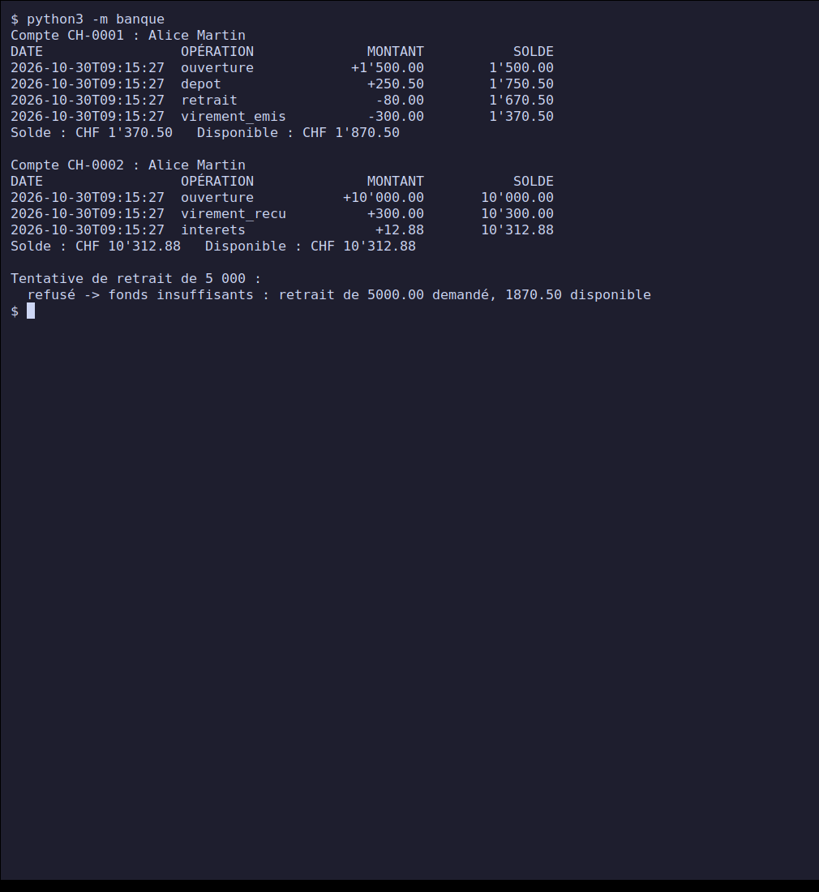
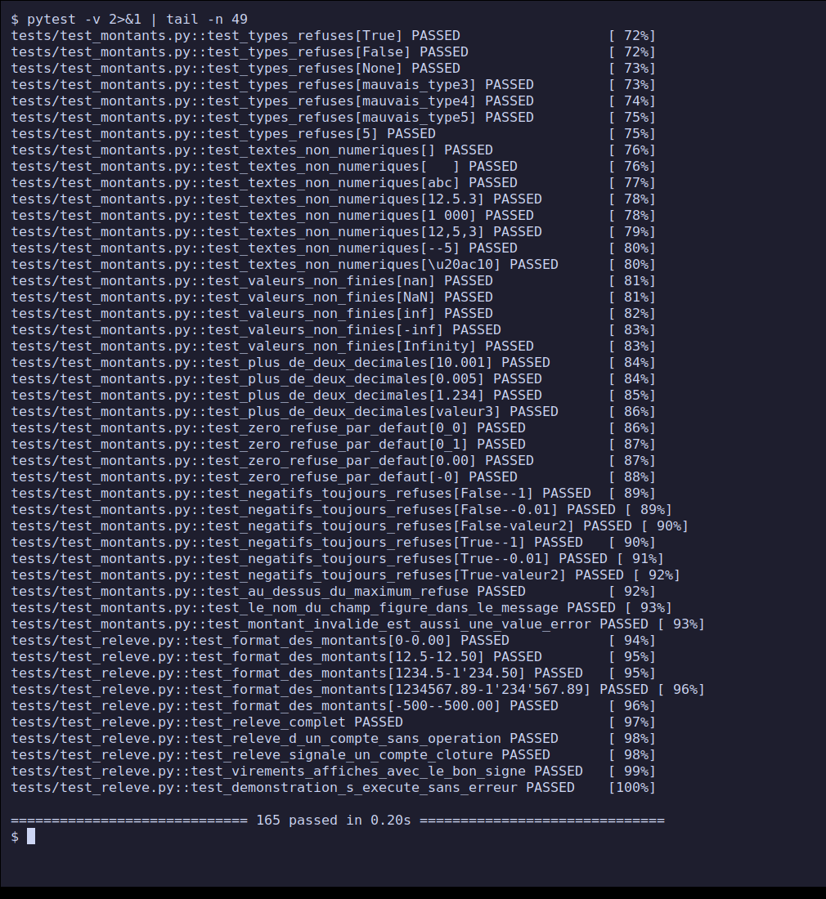
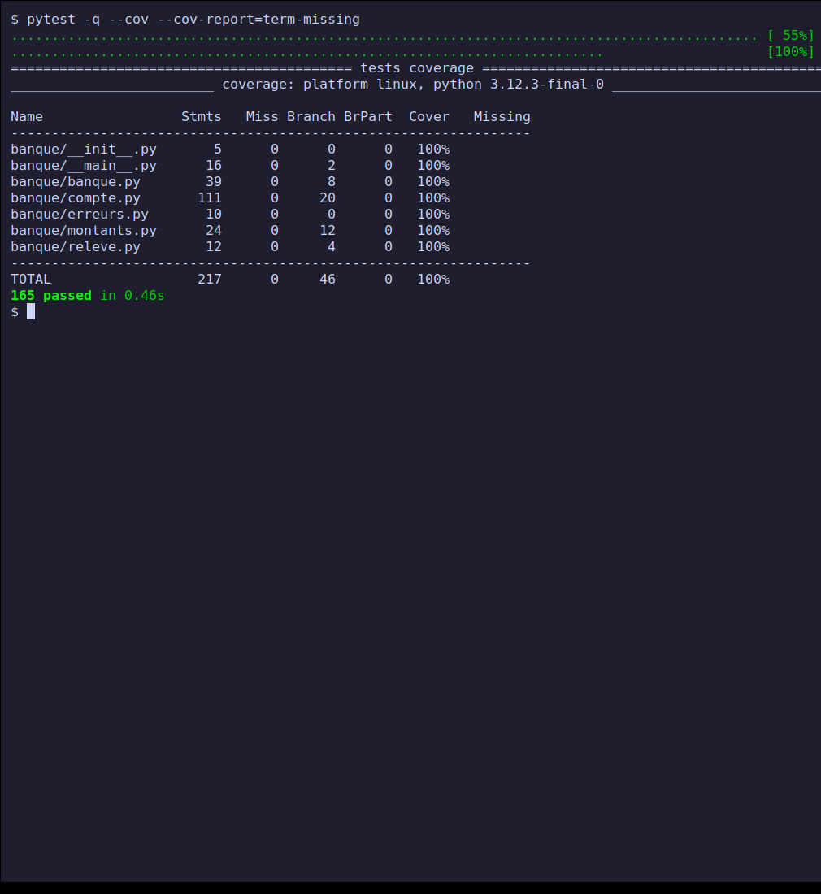
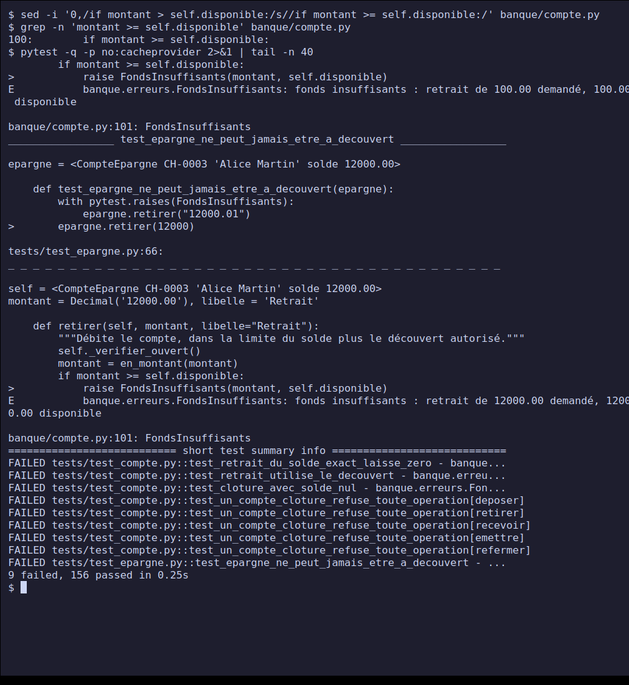
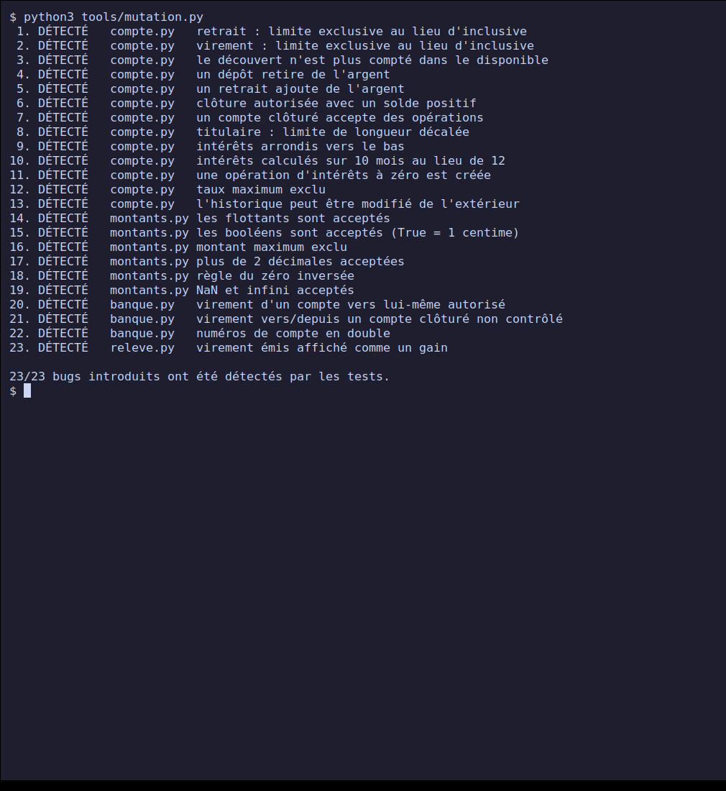

# Project 5 — Mini application tested with pytest

**PPE deliverable — Course *Python — Fundamentals* (class E3).**
Completed on **30 October 2026**. Level: advanced.

A **mini bank** in Python (current and savings accounts, transfers, interest, statements)
delivered with its **pytest test suite**: 165 tests, **100% line and
branch** coverage, and a mutation test that proves these tests really catch bugs.

## Contents

- [Progress](#progress)
- [Quick start](#quick-start)
- [Repository structure](#repository-structure)
- [The business case](#the-business-case)
- [Test strategy](#test-strategy)
- [Screenshots](#screenshots)
- [Execution report and coverage](#execution-report-and-coverage)
- [Difficulties and decisions](#difficulties-and-decisions)
- [Limitations](#limitations)
- [Mapping to the project brief](#mapping-to-the-project-brief)
- [Sources](#sources)

## Progress

| Brief step | Status |
| --- | --- |
| 1. Define the business case | Done: mini bank, see [`CAS-METIER.md`](./CAS-METIER.md) (15 rules) |
| 2. Design the module, isolating the logic from input/output | Done: only `__main__.py` prints; the time is injected |
| 3. pytest tests of the nominal cases | Done |
| 4. pytest tests of edge cases and expected errors | Done |
| 5. Run the suite and document the pass rate and coverage | Done: 165/165, 100% lines and branches, [`rapport/`](./rapport/) |
| Deliverable: module source code | [`banque/`](./banque/) |
| Deliverable: pytest test suite | [`tests/`](./tests/) |
| Deliverable: execution report (screenshot or export) | [`rapport/`](./rapport/) (4 exports) and screenshots 2 to 5 |

## Quick start

Prerequisites: Python 3.8 or newer (tested with Python 3.12.3 on Linux). The
`banque` module has no dependencies; `pytest` and `pytest-cov` are only used for the tests.

```bash
git clone https://github.com/xbkh/python-ppe-e3.git
cd python-ppe-e3/projet-5-mini-application-tests-pytest
python3 -m venv .venv && . .venv/bin/activate
pip install -r requirements.txt

python3 -m banque                                   # demo
pytest                                              # the 165 tests
pytest --cov --cov-report=term-missing              # with coverage
python3 tools/mutation.py                           # mutation testing
tools/rapport.sh                                    # regenerates rapport/
```

## Repository structure

```text
.
├── banque/
│   ├── montants.py    # amount validation (Decimal, 2 decimals, no float)
│   ├── compte.py      # CompteBancaire, CompteEpargne, Operation
│   ├── banque.py      # Banque: opening, lookup, all-or-nothing transfers
│   ├── erreurs.py     # business exceptions
│   ├── releve.py      # text statement (returns a string)
│   └── __main__.py    # demo (the only module that prints)
├── tests/
│   ├── conftest.py        # shared fixtures, fixed clock
│   ├── test_montants.py   # 49 cases
│   ├── test_compte.py     # 49 cases
│   ├── test_epargne.py    # 28 cases
│   ├── test_banque.py     # 29 cases
│   └── test_releve.py     # 10 cases
├── rapport/               # execution report (pytest, JUnit, coverage, mutation)
├── tools/
│   ├── mutation.py        # home-made mutation testing (23 bugs)
│   ├── rapport.sh         # generates rapport/
│   └── capture.sh         # generates the screenshots
├── screenshots/
├── CAS-METIER.md          # business case and rules R1 to R15
├── pytest.ini  .coveragerc  requirements.txt
└── README.md
```

## The business case

A `Banque` opens accounts and executes transfers; a current account has an authorised
overdraft; a savings account pays monthly interest. The rules (R1 to R15) are
listed in [`CAS-METIER.md`](./CAS-METIER.md), with, for each, the test file that
verifies it. A demo (`python3 -m banque`) is shown in [screenshot 1](#1-application-demo).

One design point shapes everything else: **money is a `Decimal`**, never a
`float`. `0.1 + 0.2` gives `0.30000000000000004` in binary; a `float` amount is therefore
rejected on input.

## Test strategy

77 test functions, 165 cases once the parametrisation is expanded (`@pytest.mark.parametrize`).
Each file is organised in two parts: first the **nominal cases**, then the
**edge cases and errors**.

| Family | Examples |
| --- | --- |
| **Nominal** | deposit, withdrawal, transfer, exact interest, chronological history, full statement |
| **Edges** (exact boundary value, then one cent beyond) | withdrawal of `balance + overdraft` accepted, `+ 0.01` rejected; maximum amount accepted, `+ 0.01` rejected; 60-character holder accepted, 61 rejected; 10% rate accepted, 10.1% rejected; smallest amount: 0.01 |
| **Rounding** | interest of 12.875 → 12.88 (half up); 12.87475 → 12.87; interest below half a cent → nothing is credited |
| **Expected errors** | `FondsInsuffisants`, `MontantInvalide`, `CompteFerme`, `CompteInconnu`, `OperationInvalide`, always with the message and the **balance unchanged** |
| **Hostile input** | `float`, `True`, `None`, `nan`, `inf`, `"1 000"`, `"12.5.3"`, `"€10"`, `1e2` notation, 3 decimals |
| **Properties** | the total of deposits is preserved by a transfer; the last balance in the history equals the balance; a rejected operation leaves no trace |
| **Atomicity** | a rejected transfer changes **neither** account nor their histories |

pytest techniques used: fixtures (`conftest.py`), `@pytest.mark.parametrize` (including
combined, with readable IDs), `pytest.raises(..., match=...)`, injected clock for
deterministic tests, `capsys` and `runpy` to test the demo.

### Do the tests really test anything?

100% coverage says every line **runs** during the tests, not that the
tests **check** the result. Hence [`tools/mutation.py`](./tools/mutation.py): the script
copies the code, introduces one bug at a time (a `>` becomes `>=`, a sign is flipped, a
check is removed...), reruns the suite, and requires a test to **fail**. A bug that
goes unnoticed (a "survivor") reveals a missing test.

Result: **23 bugs introduced, 23 caught.** The full list is in
[`rapport/mutation.txt`](./rapport/mutation.txt).

## Screenshots

Commands actually typed in a terminal (Xvfb virtual screen, `xterm`, `xdotool`,
`scrot`); [`tools/capture.sh`](./tools/capture.sh) regenerates them.

### 1. Application demo



Two accounts of Alice: transfer of 300 from current to savings, interest for the month
(12.88 CHF), then a withdrawal of 5,000 rejected.

### 2. The tests, one per line



End of the `pytest -v` output: each parametrised case is a separate test, 165 passed.

### 3. Line and branch coverage



### 4. A deliberate bug is detected



In a **temporary copy** of the code, `if montant > self.disponible` becomes `>=` (withdrawing
the whole available amount wrongly rejected). The suite goes from 165 passed to **9 failures**,
including the overdraft, savings and closing tests.

### 5. Mutation testing



## Execution report and coverage

Details in [`rapport/`](./rapport/): `pytest -v` output, `junit.xml`, coverage, mutation.

| Measure | Result |
| --- | --- |
| Tests passed | **165 / 165** (0 failed, 0 skipped) |
| Duration | about 0.2 s |
| Line coverage | **100%** (217 statements) |
| Branch coverage | **100%** (46 branches) |
| Mutations caught | **23 / 23** |

The `__main__.py` file is included in the coverage: the demo is itself
tested.

## Difficulties and decisions

- **Imports under pytest.** First run: `ModuleNotFoundError: No module named 'banque'`.
  Fixed with `pythonpath = .` in `pytest.ini` and a `tests/__init__.py`.
- **Coverage configuration ignored.** I had first put the `coverage` settings in
  `pytest.ini`, where it does not read them: the first report counted the test
  files themselves (a misleading "100%"). Moved to `.coveragerc`
  (`source = banque`, `branch = True`), the report now only covers the
  application code.
- **A mutation test found redundant code, not a missing test.** The first
  run let 1 mutation out of 22 survive: the `isinstance(valeur, float)` check
  was **doubled** by the following type check, which already rejected `float`s with the
  same message. The introduced bug therefore had no observable effect. I simplified the code
  (a single type check) and rewrote the mutation to target that check, plus a mutation
  on booleans.
- **Dead code removed.** My first version of the transfer contained a rollback
  (`try/except` that cancelled the debit if the credit failed). After the preliminary checks,
  the credit can no longer fail: that code could never run, hence never
  be covered or tested. Removed, and the "check everything, then act" order documented.
- **`float`s rejected rather than converted.** Converting `0.1` to `Decimal(str(0.1))` would have
  hidden the problem. Rejecting them forces the caller to pass `"0.10"`.
- **Injected time.** Without it, timestamps would change on every test.

## Limitations

- **100% coverage does not prove the absence of bugs.** Mutation testing reduces the
  risk but its 23 mutations are chosen by hand: they are not exhaustive.
  A dedicated library (for example `mutmut`) would generate many more.
- **Tests and code written by the same person**: the imagined cases share the same
  blind spots. A cross-review by a third party would be useful.
- **No persistence**: the bank lives in memory. Accounts do not survive the end of the
  program.
- **No concurrency**: the application is not designed for simultaneous access.
- **A single currency** (CHF), no fees, daily limit or variable rate.
- The business case is a personal choice, to be validated with the instructor as the brief requires.

## Mapping to the project brief

| Evaluation criterion | Weight | Where to find it |
| --- | --- | --- |
| Module design | 25% | [`banque/`](./banque/), [`CAS-METIER.md`](./CAS-METIER.md) |
| Coverage of nominal cases | 20% | "nominal cases" sections of each file in [`tests/`](./tests/), [strategy](#test-strategy) |
| Coverage of edge cases and errors | 25% | "edge cases and errors" sections, mutation testing, screenshots 4 and 5 |
| Test quality and clarity | 15% | explicit names, fixtures, parametrisation, `match=` on messages, mutation testing |
| Documentation | 15% | this README, [`CAS-METIER.md`](./CAS-METIER.md), [`rapport/`](./rapport/) |

## Sources

- Project brief: [Satom-IT-Learning-Solutions/E3 — Project 5](https://github.com/Satom-IT-Learning-Solutions/E3/blob/main/02-python-principes-de-base/projet-5-mini-application-tests-pytest.md)
- [pytest — official documentation](https://docs.pytest.org/en/stable/)
- [pytest-cov](https://pytest-cov.readthedocs.io/)
- [Python — decimal module](https://docs.python.org/3/library/decimal.html)
